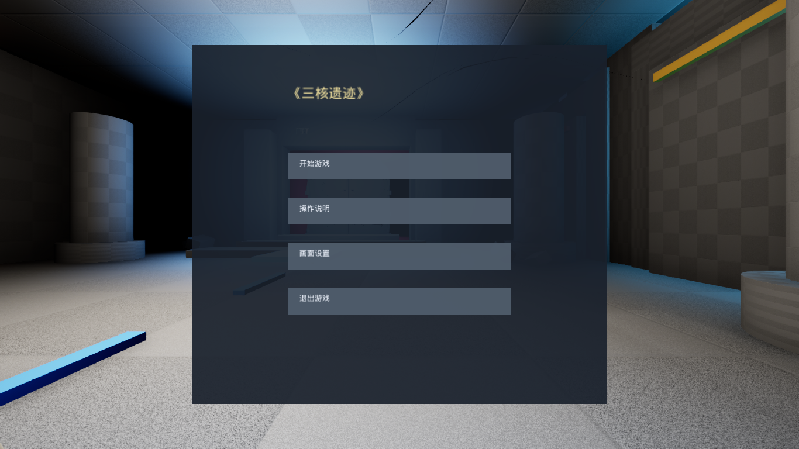
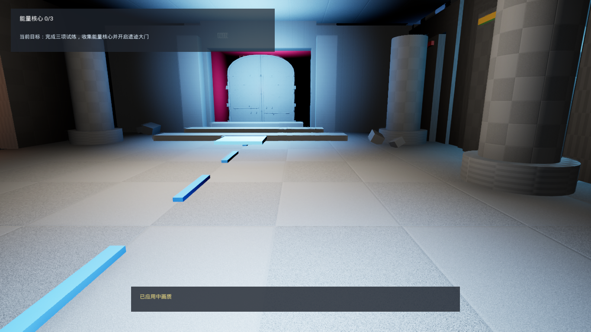
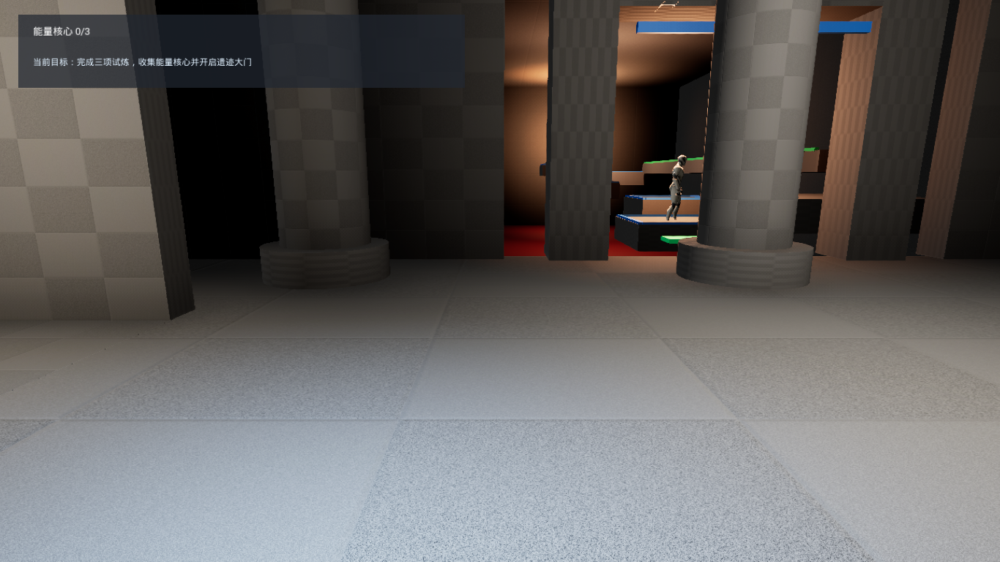
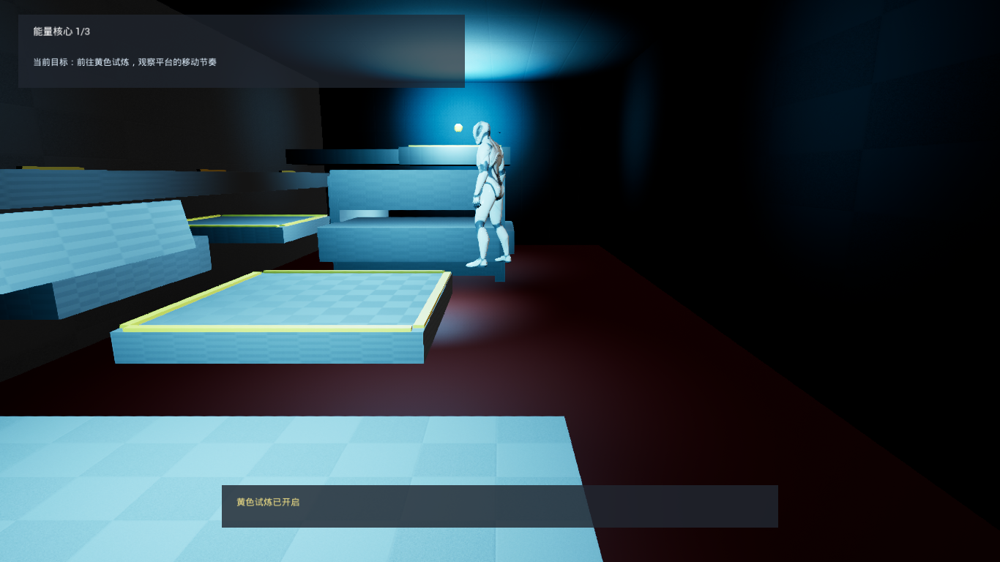
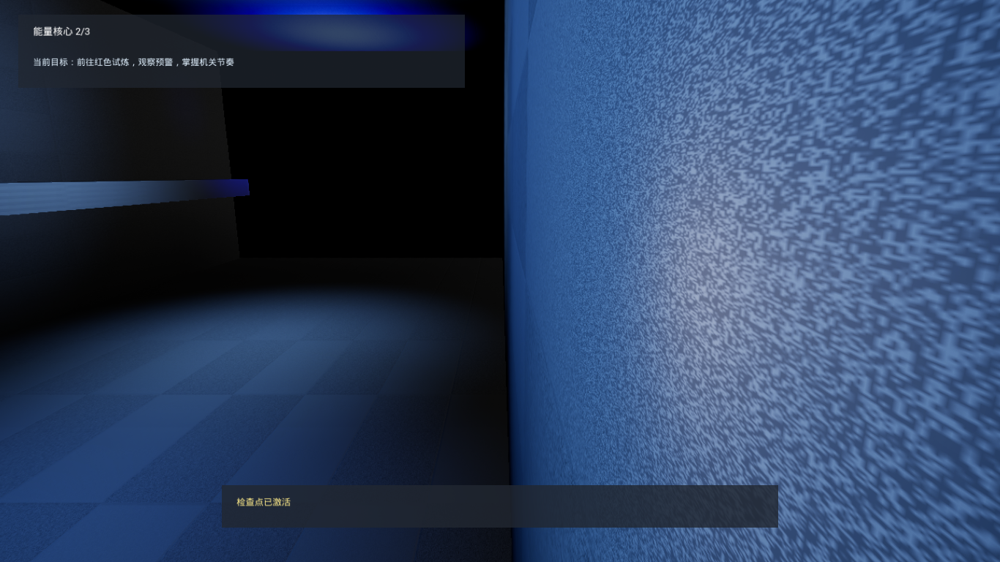
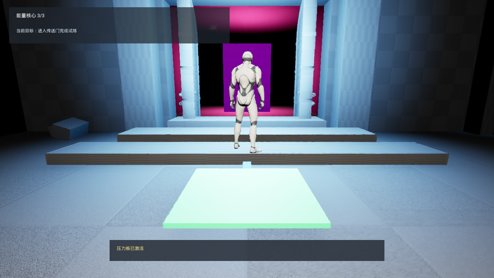

# 《三核遗迹》TinyCourse v0.1.0

一款 5～8 分钟的第三人称 3D 机关闯关测试版。玩家在遗迹大厅依次完成蓝色跳跃、黄色机械、红色危险三项试炼，收集三枚能量核心，激活压力板，开启双扇遗迹门并进入传送终点。

## 三项试炼

- **蓝色试炼**：逐级跳跃平台；掉落后从检查点快速复活。
- **黄色试炼**：观察并乘坐移动平台，按住蹲伏键穿过低矮通道。
- **红色试炼**：观察橙色预警，穿越周期危险地板和横扫机关。

## 操作

| 操作 | 按键 |
|---|---|
| 移动 | WASD |
| 调整视角 | 鼠标 |
| 跳跃 | Space |
| 蹲伏 | C / 左 Ctrl（按住） |
| 暂停 | Esc |

## 运行测试版

打开打包目录并运行 `TinyCourse.exe`。默认窗口为 1280×720，默认中画质，帧率上限 60 FPS。主菜单“画面设置”可切换低/中/高画质。

## 开发环境

- Windows 11
- Unreal Engine 5.7.4
- Visual Studio Build Tools 2022 / MSVC v143
- Windows SDK 10.0.26100.0

## 从工程打包

1. 用 Unreal Engine 5.7 打开 `TinyCourse.uproject`。
2. 确认默认地图为 `/Game/Maps/L_RuinsChambers`。
3. 选择 Windows 64 位与 Shipping 配置。
4. Cook 并打包至 `Builds/TinyCourse-Windows-v0.1.0`。

`Builds/` 不纳入 Git。

## 已知问题

- AncientDoubleDoor 未附明确许可证，本测试版仅限本地学习与验收，公开发布前必须确认授权或替换。
- 当前为低配置导向的测试版，使用简化材质、灯光和粒子；个别房间仍保留灰盒风格。
- 本版本只验证 Windows 11 / DirectX 12 环境。

## 截图

## 第三方资产

详见 [THIRD_PARTY_ASSETS.md](THIRD_PARTY_ASSETS.md)。未知授权资源不得对外发布或宣称可商业使用。
